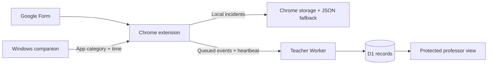

# Google Forms Exam Integrity Monitor

> **Project status · October 12, 2026:** The local Chrome and Windows monitor is verified. The Phase 3 teacher service passes local automated/API checks, and its refreshed setup and professor pages have been reviewed in Chrome. A packaged v0.2.0 Chrome session and a deployed HTTPS session still need live acceptance. The report records observations for review; it does not decide whether a student cheated.

| Phase | Status | Evidence |
| --- | --- | --- |
| Browser monitoring | **Passed** | Chrome session and JSON export |
| Windows foreground monitoring | **Passed** | Word, Notepad, Adobe Acrobat, and host interruption checks |
| Teacher monitoring | **In progress** | Local Worker, D1, API, setup page, and professor view checks |
| Combined QA | **Pending** | Begins after the remote gate |

**Start here:** [Local setup](#installation--setup) · [Student and professor guide](#user-guide) · [Latest test results](#test-results) · [Known limits](#limitations)

## PROJECT OVERVIEW

The Chrome extension records observable activity during a Google Forms session and produces a timestamped incident report for teacher review. The browser and Windows companion gates passed on October 11, 2026, with Adobe Acrobat as the verified PDF reader. Phase 3 development is on `feat/phase3-teacher-monitoring`: a local teacher service, view, setup page, and extension delivery path are implemented and have passed automated/local API checks. The packaged extension and a separate-device HTTPS flow have not passed their live gates, so remote monitoring is not yet verified.

## PROBLEM STATEMENT

A Google Forms exam alone provides limited visibility into tab changes, other webpages, and desktop apps. The current local report also depends on a student sending the JSON file afterward, so a remote teacher cannot see an active session or a missing report. The project aims to make observable activity reviewable without claiming that an event proves cheating.

## PROJECT OBJECTIVES

- Demonstrate a monitored Google Forms session and an exportable incident timeline.
- Detect another Chrome webpage and a ChatGPT page opened or activated during the session.
- Identify Word, Notepad, and a supported PDF reader when they become the Windows foreground app; identify a PDF in Chrome when observable.
- Preserve evidence labels and limitations so an instructor can interpret events fairly.
- In Phase 3, deliver incidents automatically to a teacher-only view and make missing connections visible while retaining local export.

## SYSTEM FEATURES

| Area | Behavior | Current evidence |
| --- | --- | --- |
| Chrome extension | Start/end, tab and webpage signals, ChatGPT and Chrome PDF classification, focus/fullscreen, copy/paste, local timeline, JSON export | Live Chrome gate passed on v0.1.2 |
| Windows companion | Foreground categories for Word, Notepad, and Adobe Acrobat; connection and interruption signals | Live Windows gate passed on this machine |
| Teacher service | Form records, assigned Student IDs, one-time codes, queued delivery, heartbeat/gap status, report JSON, and 30-day cleanup | Local API and page checks passed; live packaged-extension and HTTPS gates pending |

The popup's **Start in fullscreen** option is checked by default; uncheck it to keep Chrome window controls visible. The professor workspace and setup guide use a cybersecurity-inspired navy/teal palette with a saved light/dark choice. Student ID examples now use `Student 1` and `Student 2`; the teacher API accepts those labels. Foxit and SumatraPDF mappings exist but have not been demonstrated on this machine. Question timing, screenshot-key detection, resize events, and CSV export remain deferred.

## SYSTEM ARCHITECTURE / COMPONENTS

The tested Manifest V3 extension has a Google Forms content script, a service worker for session and browser events, and a popup for control and reporting. `chrome.storage.local` holds local sessions and incidents. A C# native messaging host polls the Windows foreground process and sends only an app category and timestamp to the service worker. The host has no independent report storage. The Phase 3 branch adds a Cloudflare Worker with D1, static setup and teacher pages, a password-protected teacher API, and student pairing/event APIs. The Worker is running locally; no hosted service is verified yet.

The remote path above describes the implemented Phase 3 design. Its local API path has been checked; the deployed path has not passed acceptance.

## SYSTEM WORKFLOW

On the preserved `main` build, the student opens a supported Google Form, starts monitoring, ends it, exports JSON, and sends the file to the teacher. In the Phase 3 branch, the professor registers a Form and assigned Student IDs, then gives each student a one-time code. Pairing returns that exam's Form link. The extension stores incidents locally and sends start, events, heartbeat, and end messages to the service; it retries unsent incidents. The professor sees assigned IDs, last contact, connection gaps, and a service-generated report. A confirmation page observed after a Submit attempt ends the session; manual End remains available. The professor compares the assigned ID with the separate Google Forms response. Incidents are review prompts, not automatic findings.

## TOOLS & TECHNOLOGIES

Google Chrome, Chrome Extension Manifest V3, vanilla JavaScript/HTML/CSS, Chrome storage, alarms, and native messaging APIs, Windows, a minimal C# host compiled with the .NET Framework compiler, Node.js built-in test runner, Cloudflare Worker and D1, Wrangler 4.149.0, Git, and GitHub. The Worker/D1 pairing has been exercised locally; Cloudflare deployment remains pending.

## INSTALLATION / SETUP

**Verified local monitor on `main`**

1. Open `chrome://extensions` in Chrome, enable Developer mode, choose **Load unpacked**, and select the repository folder. Copy the extension ID.
2. In PowerShell at the repository root, run `powershell -NoProfile -ExecutionPolicy Bypass -File native-host\install.ps1 -ExtensionId YOUR_EXTENSION_ID`.
3. Reload the extension, refresh the Google Form respondent page, and open the pinned popup. Its header should show the version from `manifest.json`.

The installer compiles the C# host using the .NET Framework compiler and registers Chrome native messaging for the current Windows user. The development machine's v0.1.2 ID, `ohhphckdheaeodppedfkbnljdfdoechd`, had a verified host connection on October 11. The standalone popup page can be opened at `chrome-extension://YOUR_EXTENSION_ID/popup.html` while one supported Form is open.

**Phase 3 local teacher preview on `feat/phase3-teacher-monitoring`**

1. Run `npm.cmd install`, then `npm.cmd run db:local`.
2. Create an ignored `.dev.vars` with `TEACHER_PASSWORD`, a random `SESSION_SECRET`, and `ALLOWED_EXTENSION_IDS=amlfomdhhaklmifkneplnngkbaabibgp`.
3. Run `npm.cmd run dev -- --ip 127.0.0.1 --port 8787`. Open [the local setup guide](http://127.0.0.1:8787/) and [professor workspace](http://127.0.0.1:8787/teacher.html).
4. Run `powershell -NoProfile -ExecutionPolicy Bypass -File scripts/package-demo.ps1` to refresh the ZIP and checksum. In Chrome's **Load unpacked** picker, select `dist/exam-monitor-v0.2.0/extension` (the inner folder containing `manifest.json`). Selecting `dist/exam-monitor-v0.2.0` causes a missing-manifest error. The expected ID is `amlfomdhhaklmifkneplnngkbaabibgp`. Install the bundled native host with that ID.

The v0.2.0 package targets localhost. The local password stays in `.dev.vars`, outside Git; it is not a production credential. Cloudflare authentication, D1 creation, HTTPS packaging, and separate-device verification are pending.

## USER GUIDE

**Student · verified local monitor:** Open a supported Form, choose whether to start in fullscreen, then select **Start Examination**. The popup shows session state, Windows companion state, and the incident timeline. Select **End Examination** and **Export JSON** to save the report. The `main` build requires the student to send that file to the professor.

**Student · Phase 3 preview:** Enter the one-time code, open the Form link shown by the popup, and start. The popup warns about other tabs in the same Chrome window and shows delivery status. A confirmed submission should end the session; **End Examination** remains the fallback. Local JSON export remains available if delivery fails.

**Professor · Phase 3 preview:** Sign in, register a published Form with a required Student ID question, and assign labels such as `Student 1` and `Student 2`. Give each student their own code. In the professor workspace, select the exam, refresh activity, review contact and incident records, and download the service JSON. Match the assigned ID with the separate Google Forms answer; a code does not verify physical identity.

The setup guide and professor workspace offer saved light/dark modes. In fullscreen, Ctrl+Tab changes Chrome tabs and F11 exits fullscreen; those changes can be recorded. A desktop app signal means the app became active, not that a document was read.

For a short local presentation, use a practice Form, confirm v0.1.2 and **Desktop monitor: connected**, and start with fullscreen unchecked. Visit another webpage, `chatgpt.com`, and a Chrome PDF; then bring Word, Notepad, and Adobe Acrobat forward one at a time. Return to the Form, review the timeline, end, and export JSON. The report should show hostnames and app categories without page paths, document names, or answers.

Use the published [Systems Integration and Architecture Fundamentals practice quiz](https://docs.google.com/forms/d/e/1FAIpQLSdOyiXOUU2YWqp2RFh6SR_-dPf8ZmixAjrT7bZ4EE0TnS7oVQ/viewform) for browser demonstrations. It has 10 required multiple-choice questions, four choices each, one point each, and a verified answer key. It collects no email addresses and asks for no personal information. The owner can edit it in [Google Forms](https://docs.google.com/forms/d/1AflTsgzB8kgf_uiEODvX0KPT8boAp5xWdPVcTl9yW-M/edit). Use dummy answers; the extension does not record them. **This practice quiz lacks the Phase 3 required Student ID question.** Add that question to a dedicated Phase 3 test Form before validating professor matching.

## QUALITY ASSURANCE & TESTING

Phase gates and required demonstrations are defined in `GOOGLE_FORMS_EXAM_MONITOR_MVP_CONTEXT.md`. Run `npm.cmd test` for the extension, host, and service checks. With the local Worker running, set `SERVICE_TEST_URL=http://127.0.0.1:8787` and `SERVICE_TEST_PASSWORD` to the local teacher password before `npm.cmd test` to include the live API and simulated extension delivery tests. Use `tests/MANUAL_BROWSER.md`, `tests/MANUAL_DESKTOP.md`, and `tests/MANUAL_REMOTE.md` for Chrome, Windows, and Phase 3 checks. The earlier browser and desktop live gates passed on the development machine. The Phase 3 Chrome package and deployed HTTPS gates are still pending; final combined QA is Phase 4.

## TEST RESULTS

| Checkpoint | Result | What was verified |
| --- | --- | --- |
| Phase 1 browser | **Passed** · October 10–11 | Form session, webpage/ChatGPT/PDF signals, focus/fullscreen, persistence, JSON privacy, after-End boundary |
| Phase 2 Windows | **Passed** · October 11 | Word, Notepad, Acrobat, host interruption/recovery, no incident after End |
| Phase 3 local checks | **19/19 passed** · October 12 | Teacher API, one-time codes, retry, privacy, local UI, setup connection, and retention |
| Phase 3 Chrome + HTTPS | **Pending** | Fresh-profile packaged extension and separate-device remote path |

Earlier browser and Windows test notes

Phase 0 local checks (October 10, 2026): all five project skills passed `quick_validate.py` with UTF-8 enabled; a content check confirmed all 14 requested README headings and the six priority monitoring areas in the MVP context.

Phase 1 automated checks (October 10, 2026; Windows, Node.js 22.19.0): `node --test tests/browser.test.js` passed 9/9 checks covering URL classification, session lifecycle, deduplication, privacy fields, content-script validation and invalidation handling, control-page authorization, monitored-tab navigation, blank-tab counting, Form-tab interruption, window focus and fullscreen transitions, persistence across a simulated service worker restart, and parseable JSON report shape. `node --check` passed for the changed extension JavaScript.

Phase 1 manual gate (October 10, 2026; Windows, Chrome 154.0.8037.98): the unpacked extension loaded with a visible service worker. A supported Google Form started and ended from the toolbar popup; a second Start was disabled while active, and the two-event control run had one `EXAM_STARTED` and one `EXAM_ENDED`. A longer run recorded `example.com` as a webpage and `chatgpt.com` as a page opened or activated with usage unverified; it also recorded tab switches, fullscreen exit/restoration, copy, paste, and window focus loss/restoration. The active session and timeline survived a control-page reload and extension reload. A completed 20-event JSON export parsed successfully: all incidents had the same session ID, ordered ISO timestamps, valid severities, `CHROME` source, null app categories, and only the two hostnames. It contained no Form path, ChatGPT path, or dummy answer text. After End, webpage, ChatGPT, copy, paste, and focus actions left the count at 20. No duplicate event was observed for each single action. Phase 1 passed its browser gate.

During testing, Chrome showed an `Extension context invalidated` error from a Form content script left open across an extension reload. The content script now catches that synchronous error; the Form was refreshed before the copy/paste retest. A separate clean-reload check of that fix is pending.

Phase 2 implementation checks (October 11, 2026; Windows, Node.js 22.19.0): `node --test tests/browser.test.js tests/host.test.js` passed 12/12. The extension tests covered native message validation, category-only incident fields, end-of-session boundaries, host disconnect/interruption, and continued browser recording. The host test compiled the C# executable, read its length-prefixed `READY` and `FOREGROUND_CHANGED` frames, confirmed the category-only fields, and sent `STOP` for a clean exit. The generated host manifest allows this development machine's unpacked extension ID, and the current-user Chrome registry entry points to it.

Phase 2 partial live report review (October 11, 2026): a locally exported 28-incident session contained Windows-host events for Word and Notepad, a Chrome PDF event for `www.w3.org`, one native-host interruption, and another Word event after the interruption. All incidents shared the session ID and were chronological; the JSON contained no full URLs or Windows file paths. It did not contain a `PDF_READER` incident. Repeated `WINDOW_FOCUS_LOST` events without intervening restoration exposed a duplicate-signal defect. The service worker now records focus transitions. The export also contained internal tab and window IDs; the report builder now omits them. The later browser and desktop regressions verified these fixes.

Browser adjustment checks (October 11, 2026; Windows, Node.js 22.19.0): `node --test tests/browser.test.js tests/host.test.js` passed 13/13 after adding the normal-window option. The new check confirms a normal start keeps Chrome's window state normal while later fullscreen entry and exit still create incidents. `node --check` passed for the changed JavaScript.

Browser regression and QA (October 11, 2026; Windows, unpacked Chrome extension `v0.1.2`): an earlier live export exposed missed ChatGPT and PDF events when their tabs were not active as URL updates arrived. The service worker now records URL navigations during the session even if the tab remains in the background. The follow-up `node --test tests/browser.test.js tests/host.test.js` passed 14/14, including a new background-navigation and after-End test. In a fresh session confirmed **Monitoring**, Chrome navigated to `example.com`, `chatgpt.com`, and a PDF at `www.w3.org`. The 8-event JSON export recorded exactly one `WEBPAGE_OPENED`, one `AI_SITE_OPENED`, and one `PDF_OPENED`, each with the expected hostname and before `EXAM_ENDED`. It had one Start and one End, ordered timestamps, one session ID, `CHROME` sources, null app categories, and session fields limited to `id`, `startedAt`, and `endedAt`. It contained no full URL, internal tab/window ID, PDF path, private ChatGPT path, or dummy Form answer. Focus loss/restoration followed state transitions rather than repeating consecutive loss events. The browser regression passed. A separate initial `v0.1.2` attempt did not reach **Monitoring** and was excluded from this result.

Phase 2 live gate (October 11, 2026; Windows, Chrome 154.0.8037.98, unpacked extension `v0.1.2`): the popup showed **Monitoring** and **Desktop monitor: connected**. Word became the foreground process before and after a test host termination; the host process restarted automatically. A 27-event JSON export recorded two `WORD`, one `NOTEPAD`, and three `PDF_READER` foreground events. Adobe Acrobat was the installed reader; each reader event means Acrobat became active, without claiming a document was opened. The report also contained two Chrome `PDF_OPENED` events for `www.w3.org`, one `MONITORING_INTERRUPTED` event with `WINDOWS_HOST` source, and a `WEBPAGE_OPENED` event after the interruption. After End, another webpage and Word activation added no incident. The popup summary matched the 27 exported events. QA confirmed one Start and one End, ordered timestamps, one session ID, no event after End, category-only desktop incidents, hostname-only browser incidents, and no full URLs, file paths, internal tab/window IDs, or dummy Form answer. The desktop gate passed on this machine.

Pre-remote baseline QA review (October 11, 2026; recorded before the phase change): the browser and desktop live reports together cover all six original demonstrations and the existing local MVP controls. The 8-event browser report contains the webpage, ChatGPT, and Chrome PDF labels; the 27-event desktop report contains Word, Notepad, Acrobat, host interruption/recovery, browser continuation, and the post-End boundary. Both reports use observation wording and pass the privacy-field checks above. `node --test tests/browser.test.js tests/host.test.js` passed 14/14 after the final local code change. A fresh practice Form should be used for presentation so no real application answers are visible. Phase 3 remote results and Phase 4 combined QA results are pending.

Phase 3 local implementation checks (October 12, 2026; Windows, Node.js 22.19.0, Wrangler 4.149.0, local D1): the verified `v0.1.2-local` baseline was promoted to `main` and tagged; `feat/phase3-teacher-monitoring` was created from it. `npm.cmd run db:local` applied the D1 schema. With the local Worker running, `npm.cmd test` passed 19/19: the original 14 browser/host checks plus paired extension simulation, teacher API flow, CORS access, public health check, and signed-in Form URL canonicalization. The API checks covered wrong and reused codes, unauthorized teacher access, atomic code generation, event retry deduplication, manual and observed-submission endings, no post-End event, service report privacy, and wrong-Form refusal. In the local teacher page, sign-in, exam creation, one-time code generation, assigned IDs, session grouping, timeline, and a simulated connection gap were visible. The public page's **Check connection** button reported service version `0.2.0`. The setup ZIP returned HTTP 200 and its file hash matched the published SHA-256. Invoking the local scheduled handler after aging a test session removed its incident and session rows; aging a test exam and code removed both rows. A live practice Form stayed on `/viewform` after failed required-question validation and used `/forms/u/0/d/e/.../formResponse` after a dummy successful submission; the extension route matcher was updated for that path. The new `v0.2.0` unpacked extension has not yet completed a live Chrome session, and no HTTPS/separate-device check has passed. Phase 3 remains open.

Phase 3 interface check (October 12, 2026; local Chrome and Worker): the updated professor workspace displayed exam records, assigned/active/gap/ended counts, student status cards, and a four-event timeline from an existing local record. The setup guide's connection check reported `v0.2.0`. Light and dark toggles rendered on both pages, and the choice persisted when navigating between them. After the API accepted `Student 1` and `Student 2` labels, the full local suite passed 19/19 again. The Phase 3 live extension and remote gates remain open.

## LIMITATIONS

Opening ChatGPT does not prove its use. A foreground app event does not prove a document was opened or read. Another browser or device, unsupported PDF viewer, and some Chrome PDF locations may be unobservable. The `main` report requires student export and handoff; students can withhold it or disable monitoring. Phase 3 can expose missing connections but cannot prove a student kept monitoring enabled or establish identity on an unmanaged device. The report is a prototype record, not tamper-proof evidence. The current Phase 3 ZIP points to localhost and works only where that service is reachable; its live Chrome and hosted gates remain open.

## CONCLUSION

The browser and Windows desktop phases are ready for a local demonstration on the development machine. The Phase 3 teacher service and setup page work in local API and UI checks, while the packaged Chrome extension and HTTPS remote flow still need live acceptance. Final combined QA follows in Phase 4. The report records reviewable observations without making a cheating verdict.

## APPENDICES

- [Authoritative MVP context](GOOGLE_FORMS_EXAM_MONITOR_MVP_CONTEXT.md)
- Original context: Git `main`
- Project workflows: `.agents/skills/` and `AGENTS.md`
- Browser manual check: `tests/MANUAL_BROWSER.md`
- Desktop manual check: `tests/MANUAL_DESKTOP.md`
- Phase 3 acceptance check: `tests/MANUAL_REMOTE.md`
- Local setup and teacher view: `public/`
- Teacher Worker and D1 migration: `server/`
