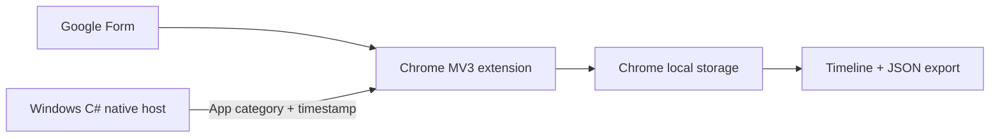

<table><tr><td width="112"></td><td><h1>IntegriTest</h1>
Google Forms exam activity records for professor review.
</td></tr></table>

  

[Setup](#installation--setup) · [User guide](#user-guide) · [Architecture](#system-architecture--components) · [Test results](#test-results) · [Limitations](#limitations)

> **Stable branch:** `main` contains the tested local v0.1.2 Chrome and Windows monitor. The teacher service, class rosters, and remote delivery are being built on `feat/phase3-teacher-monitoring`; they are not part of this stable build. Incidents are observations for review, not cheating verdicts.

## PROJECT OVERVIEW

IntegriTest records observable browser and supported Windows foreground activity during a Google Forms examination. This stable build stores incidents locally, displays a timeline, and exports JSON for professor review.

## PROBLEM STATEMENT

Google Forms does not show a professor when the exam window loses focus, another webpage opens, or a supported desktop app comes forward. A local report gives reviewable context, though delivery currently depends on the student sending the exported JSON.

## PROJECT OBJECTIVES

- Demonstrate a monitored Form session and a readable, exportable timeline.
- Record webpage, ChatGPT page, Chrome PDF, Word, Notepad, and supported PDF-reader signals when observable.
- Keep activity fields limited to categories, timestamps, sources, app categories, and needed hostnames.

## SYSTEM FEATURES

The extension offers start/end controls, tab and focus signals, fullscreen changes, copy/paste attempts, local incident storage, a timeline, and JSON export. The Windows companion classifies foreground Word, Notepad, and Adobe Acrobat. A PDF in Chrome is classified through browser activity. **Start in fullscreen** is optional; uncheck it to keep Chrome controls visible. Question timing, screenshot-key detection, CSV, and scoring are deferred.

## SYSTEM ARCHITECTURE / COMPONENTS

The extension service worker handles browser events and session boundaries. The native host reports a category without document contents, window titles, or file paths. Phase 3's Worker/D1 architecture is documented on its development branch and requires its own acceptance gate.

## SYSTEM WORKFLOW

The student opens a supported Google Form, starts monitoring from the extension, completes the quiz, ends monitoring, exports JSON, and sends the report to the professor. The professor reviews the events alongside the separate Form response. A recorded event does not establish intent or identity.

## TOOLS & TECHNOLOGIES

Google Chrome Manifest V3, JavaScript/HTML/CSS, Chrome storage and native messaging APIs, Windows, a C# foreground host compiled with the installed .NET Framework compiler, PowerShell, Node.js tests, Git, and GitHub. The project is [MIT licensed](LICENSE).

## INSTALLATION / SETUP

1. In Chrome, open `chrome://extensions`, enable **Developer mode**, select **Load unpacked**, and choose this repository folder. Copy the extension ID shown by Chrome.
2. In PowerShell at the repository root, run `powershell -NoProfile -ExecutionPolicy Bypass -File native-host\install.ps1 -ExtensionId YOUR_EXTENSION_ID`.
3. Reload the extension, refresh the Form respondent page, and open the popup. Check that it shows v0.1.2 and **Desktop monitor: connected** when the companion is available.

See the [browser test steps](tests/MANUAL_BROWSER.md) and [desktop test steps](tests/MANUAL_DESKTOP.md) for a reproducible walkthrough.

## USER GUIDE

Open a supported Form respondent page, choose whether to start in fullscreen, then select **Start Examination**. Visit the quiz as normal. The popup shows status and an incident timeline. Select **End Examination** and **Export JSON** when finished. Send the JSON to the professor using the agreed class process; this stable build has no teacher upload or live view.

The published [10-question Systems Integration and Architecture practice Form](https://docs.google.com/forms/d/e/1FAIpQLSdOyiXOUU2YWqp2RFh6SR_-dPf8ZmixAjrT7bZ4EE0TnS7oVQ/viewform) is available for a local demonstration. Use nonpersonal answers; the extension does not capture them.

## QUALITY ASSURANCE & TESTING

Run `node --test tests/*.test.js` for repeatable extension and Windows host checks. The [MVP context](GOOGLE_FORMS_EXAM_MONITOR_MVP_CONTEXT.md) defines the phase gates. The local browser and desktop phases passed; final combined QA will follow the remote teacher gate on the development branch.

## TEST RESULTS

| Gate | Observed result |
| --- | --- |
| Chrome v0.1.2 | Passed local start/end, webpage and ChatGPT classification, focus/fullscreen, copy/paste, persistence, timeline, and JSON export |
| Windows v0.1.2 | Passed Word, Notepad, Adobe Acrobat, Chrome PDF, host interruption, and no incident after End on the development machine |
| Phase 3 remote delivery | In development on a separate branch; no HTTPS or separate-device result is claimed |

Test context

The local browser and Windows gates were demonstrated on October 10–11, 2026. The foreground app signal indicates that an application became active; it does not show what was read or typed. The later teacher-service checks do not change the stable v0.1.2 result.

## LIMITATIONS

The extension cannot observe another browser or device. A foreground app signal does not prove that a document was read. Opening ChatGPT does not prove it was used. Unsupported PDF readers may appear only as external activity. Local JSON can be cleared or altered by someone controlling the device; remote delivery is under development.

## CONCLUSION

The stable local monitor provides a tested incident report for review. Remote professor access and automatic delivery need the Phase 3 local and HTTPS gates before release.

## APPENDICES

- [MVP context](GOOGLE_FORMS_EXAM_MONITOR_MVP_CONTEXT.md)
- [Browser manual check](tests/MANUAL_BROWSER.md)
- [Windows manual check](tests/MANUAL_DESKTOP.md)
- [MIT license](LICENSE)
