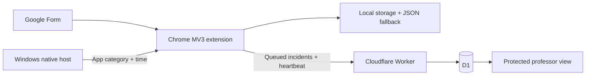

<h1 align="center">IntegriTest</h1>

   

<a href="#installation--setup">Setup</a> · <a href="#user-guide">Professor guide</a> · <a href="#system-architecture--components">Architecture</a> · <a href="#test-results">Test results</a> · <a href="#limitations">Limitations</a>

> **Status · October 13, 2026:** The v0.1.2 local Chrome and Windows monitor on `main` passed live checks. Phase 3 remains on `feat/phase3-teacher-monitoring`. The v0.3.1 code passed 23 local automated checks. Its professor table was inspected live in dark and light modes, and its paired-session End guard and marked early stop passed a guided Chrome check. The earlier v0.3.0 extension demonstrated delivery, supported browser and Windows categories, confirmed-submission ending, and outage recovery. Live connection-gap display during an actual outage, HTTPS deployment, and separate-device monitoring remain unverified. Incidents are observations, not cheating verdicts.

## PROJECT OVERVIEW

IntegriTest records observable activity during a Google Forms examination. A Chrome extension captures browser signals, a Windows companion classifies supported foreground apps, and a teacher service groups received incidents under an exam and assigned roster entry. The professor scans a live activity table and opens a full report when needed.

## PROBLEM STATEMENT

Google Forms does not give a professor a record of tab changes or supported desktop apps during a quiz. The tested local monitor exports JSON, but remote review also needs automatic delivery and visible connection gaps. IntegriTest adds those records without claiming an incident proves misconduct.

## PROJECT OBJECTIVES

- Record a monitored Form session, another webpage, a ChatGPT page, a Chrome PDF, Word, Notepad, and a supported PDF reader when observable.
- Keep incident data to categories, timestamps, sources, app categories, and needed hostnames.
- Let a professor register a Form, reuse a class roster, issue one-time codes, and review activity by assigned name and ID.
- Deliver incidents during the exam, retry after an interruption, and retain a local JSON fallback.

## SYSTEM FEATURES

| Component | Behavior | Evidence |
| --- | --- | --- |
| Chrome extension | Start/end, tab and focus changes, fullscreen, copy/paste, local timeline and JSON, webpage/ChatGPT/PDF categories; paired-session End guard and marked early stop | v0.1.2 and v0.3.0 live checks passed; v0.3.1 End guard and early stop passed automated and guided Chrome checks |
| Windows companion | Foreground Word, Notepad, and verified Adobe Acrobat categories; disconnect signal | v0.1.2 live gate passed on the development machine |
| Professor service | Protected Form records, `.xlsx` classes, one-use codes, 10-second dashboard refresh, student status and latest activity table, full report on request, JSON, 30-day cleanup | v0.3.1 API and live table checks passed; full local and HTTPS gates pending |

The popup warns when other tabs are open in the same Chrome window. **Start in fullscreen** is off by default so window controls remain visible; students can opt in. A confirmed Form submission ended monitoring in the tested practice Form. In v0.3.1, normal **End Examination** is unavailable during a paired session before confirmed submission; **Report a problem and stop early** is a marked fallback for technical failure. Local-only sessions retain manual End. This UI guard cannot stop a student from disabling the extension or closing Chrome. Question timing, screenshot-key detection, CSV, and scoring are deferred.

## SYSTEM ARCHITECTURE / COMPONENTS

The extension service worker validates session boundaries and retries delivery. The C# native host sends categories and timestamps, without document contents or window titles. D1 keeps names and IDs in assignment/session metadata; incident rows keep only approved activity fields. The current service runs locally. The deployed arrow is a design until the HTTPS gate passes.

## SYSTEM WORKFLOW

1. The professor publishes a Google Form and registers its respondent `viewform` link in the teacher view.
2. The professor imports a class `.xlsx` whose first sheet has **Student ID** and **Name** headers. The browser previews and validates it, then sends only confirmed names and IDs. Manual ID-only assignments remain available.
3. Assigning a class to an exam generates fresh one-use codes, shown once for copying or a plain-text download. The professor shares each code privately.
4. A student pairs the extension, opens the registered Form from the popup, and starts. The service receives incidents and heartbeats; the dashboard refreshes every 10 seconds. A connection gap means contact was missed.
5. Observed submission confirmation ends a paired session. A technical issue can be marked as an early stop; local-only sessions retain manual End. The professor downloads the service JSON and matches the roster entry with the separate Google Forms response manually.

A code identifies an assigned roster entry, **not a verified physical person**. The Form needs no Student ID question for pairing.

## TOOLS & TECHNOLOGIES

Chrome Manifest V3, JavaScript/HTML/CSS, Chrome storage/alarms/native messaging, Windows and a C# foreground host, Cloudflare Workers and D1, Wrangler, a pinned bundled `read-excel-file` reader, Node.js tests, Git, and GitHub. The project is [MIT licensed](LICENSE).

## INSTALLATION / SETUP

**Verified local baseline (`main`):** Load the repository folder at `chrome://extensions` as an unpacked extension. Run `native-host/install.ps1` with the Chrome extension ID, then reload the extension and refresh the Form. See [manual browser](tests/MANUAL_BROWSER.md) and [desktop](tests/MANUAL_DESKTOP.md) steps.

**Phase 3 local build (`feat/phase3-teacher-monitoring`):**

1. Run `npm.cmd install`, `npm.cmd run build:roster`, then `npm.cmd run db:local`.
2. Put `TEACHER_PASSWORD`, a random `SESSION_SECRET`, and `ALLOWED_EXTENSION_IDS=amlfomdhhaklmifkneplnngkbaabibgp` in an ignored `.dev.vars` file.
3. Run `npm.cmd run dev -- --ip 127.0.0.1 --port 8787`. Open the [local setup guide](http://127.0.0.1:8787/) and [professor workspace](http://127.0.0.1:8787/teacher.html).
4. Run `powershell -NoProfile -ExecutionPolicy Bypass -File scripts/package-demo.ps1`. In Chrome's **Load unpacked** picker, select the inner `dist/integritest-v0.3.1/extension` folder containing `manifest.json`. Its expected ID is `amlfomdhhaklmifkneplnngkbaabibgp`. Install the bundled native host with that ID.

The v0.3.1 ZIP targets localhost. Its [SHA-256 file](public/downloads/integritest-v0.3.1.sha256) identifies the exact package. The local password is outside Git. A reachable HTTPS package will be built for its exact deployed origin after the local gate passes.

**HTTPS release after the local gate:** Cloudflare Workers and D1 are the selected host because the same Worker, static pages, scheduled cleanup, and D1 schema already run locally. Sign in with `npx wrangler login`, create `integritest` with `npx wrangler d1 create integritest`, replace the placeholder D1 ID in `wrangler.jsonc`, and apply migrations with `npx wrangler d1 migrations apply integritest --remote`. Set `TEACHER_PASSWORD`, `SESSION_SECRET`, and `ALLOWED_EXTENSION_IDS` with `npx wrangler secret put NAME`, then run `npx wrangler deploy`. Rebuild the package with `scripts/package-demo.ps1 -ServiceOrigin https://YOUR_WORKER_ORIGIN`, verify its checksum, and deploy the updated static assets. Pairing, delivery, gaps, ending, teacher access, and JSON privacy still require a separate Windows device before remote monitoring is called operational. See [Cloudflare's D1 local development](https://developers.cloudflare.com/d1/best-practices/local-development/) and [static assets](https://developers.cloudflare.com/workers/static-assets/binding/) guides.

| Host | Fit for this project |
| --- | --- |
| [Cloudflare Workers](https://developers.cloudflare.com/workers/platform/limits/) + [D1](https://developers.cloudflare.com/d1/platform/pricing/) | **Selected.** No service rewrite; Free allowances include 100,000 Worker requests/day, 5 million D1 rows read/day, 100,000 rows written/day, and 5 GB stored. This is an estimate of suitability for a controlled class demonstration, not a measured hosted result. |
| [Render Free](https://render.com/docs/free) | A service can sleep after 15 minutes idle; Free Postgres expires after 30 days. |
| Vercel + [Supabase Free](https://supabase.com/docs/guides/platform/free-project-pausing) | Requires splitting or rewriting the current Worker/D1 path; inactive Free projects can pause. |
| [GitHub Pages](https://docs.github.com/en/pages/getting-started-with-github-pages/creating-a-github-pages-site) | Can serve a guide, but cannot run the teacher API or database. |

## USER GUIDE

**Student:** Obtain a one-time code from the professor. Pair in the extension popup, open the registered Form link, choose whether to start in fullscreen, and select **Start Examination**. After submitting, check the status. If it stays Monitoring after confirmed submission, contact the professor. For a technical failure, **Report a problem and stop early** records a distinct early end. Local JSON export is a fallback if delivery fails.

**Professor:** Sign in at the [workspace](public/teacher.html). Import a class workbook, inspect the preview and row errors, and save it. Register a published Form and assign the class to that exam. Copy or download the codes when shown. The table refreshes every 10 seconds and shows each student's code state, start time, Low/Medium/High counts, connection status, latest activity, and event name. **View full report** opens that student's timeline and service JSON. The raw code is shown only when issued. Match Form responses separately.

The [public setup page](public/index.html) explains installation and what is recorded. The published [10-question Systems Integration and Architecture practice Form](https://docs.google.com/forms/d/e/1FAIpQLSdOyiXOUU2YWqp2RFh6SR_-dPf8ZmixAjrT7bZ4EE0TnS7oVQ/viewform) can be used for activity demonstrations. Its answers are not collected by the extension.

## QUALITY ASSURANCE & TESTING

Run `npm.cmd test`. With the local Worker running, set `SERVICE_TEST_URL=http://127.0.0.1:8787` and `SERVICE_TEST_PASSWORD` to the local teacher password to include API checks. Use [browser](tests/MANUAL_BROWSER.md), [desktop](tests/MANUAL_DESKTOP.md), and [remote](tests/MANUAL_REMOTE.md) manual steps for acceptance. Phase 4 combined QA waits for the Phase 3 remote gate.

## TEST RESULTS

| Check | Observed result |
| --- | --- |
| v0.1.2 Chrome and desktop gates | Passed on the development machine, including Word, Notepad, Adobe Acrobat, Chrome PDF, and host interruption |
| v0.2.0 local teacher session and after-End check | Paired and connected; service received 46 ordered incidents including webpage, ChatGPT, Chrome PDF, and Notepad; manual End recorded. On October 12, a later Chrome visit to `iana.org` left the ended service session at 46 incidents. |
| v0.3.0 automated tests with local Worker | **22/22 passed** on October 12, 2026, including class reuse, one-use codes, snapshots, privacy, retry, and end boundary |
| 30-day local retention check | A disposable old exam, code, session, and incident were removed by the scheduled handler; the earlier 46-event session remained |
| Local contact-gap check | An aged active session showed `GAP`; a heartbeat returned it to `CONNECTED` |
| Wrangler deployment dry run | Worker, D1 binding, and 13 current public assets bundled successfully; no deployment was made |
| v0.3.0 live local student flow | Student 1 paired and connected; the service received 46 unique, ordered incidents including a webpage, ChatGPT, Chrome PDF, Notepad, Word, and Adobe Acrobat before manual End. Student 3's incomplete Form showed validation errors and stayed Monitoring; its completed practice Form ended automatically with `FORM_SUBMISSION_OBSERVED` and 41 unique, ordered incidents. A later page visit left the service report at 41. Service JSON contained approved incident fields and no answer text, full URLs, or document paths. |
| v0.3.0 live professor flow | Password-protected view showed Student 3's ended status, 41-event timeline, and service JSON link. A dummy `.xlsx` preview kept text ID `0012`, the class saved, and assigning it generated one-use codes and Student 1/Student 2 rows. Exam-title search narrowed 77 local test records to the selected exam. |
| v0.3.0 actual outage recovery | Student 4's `www.iana.org` event was captured on October 12 at 11:48:50 UTC while port 8787 had no listener and received by D1 on October 13 at 04:26:35 UTC after Chrome and the service returned. The ended session has 89 incidents with 89 unique IDs and sequences 1–89. The teacher's gap label during this outage was not observed live. |
| v0.3.1 automated and professor UI checks | **23/23 passed** with the local Worker on October 13, including refusal of normal End before confirmation, a separate early-stop reason, severity counts, latest-event fields, and one-use code state. The professor table and full-report action were inspected in Chrome in dark and light modes. |
| v0.3.1 paired-session early stop | Student 5 paired and started with the Windows monitor connected. Normal End was disabled and the marked problem-stop control was available. The student used that control before submitting. The professor table showed **Ended early** and **Stopped before confirmed submission**. D1 stored `STUDENT_STOPPED_EARLY` with 16 incidents, 16 unique IDs, and sequences 1–16. Opening `www.iana.org` after End left the report at 16 incidents. |
| Separate-device HTTPS gate | **Pending.** No hosted service or remote device test has been run. |

Earlier test history

The local browser and Windows phases were demonstrated before the teacher service was added. The v0.2.0 live run established local pairing and delivery, and a later post-End page visit left the service report unchanged. The v0.3.0 guided Chrome/Form and professor checks above are partial local gate evidence. The automatic approval system reached a usage limit during the original after-End visit; it did not report an unsafe-action finding.

## LIMITATIONS

The extension cannot observe another browser or device. A foreground app category does not reveal what was read or typed. Opening ChatGPT does not prove it was used. A connection gap cannot show activity during the gap. Anyone controlling an unmanaged device may disable monitoring; a code cannot verify physical identity. Dedicated PDF readers other than Adobe Acrobat need explicit verification. Report retention is 30 days after the service cleanup runs.

## CONCLUSION

The local monitor is demonstrable. Phase 3's roster, delivery, Form submission, outage recovery, professor table, and paired-session end control have the local evidence listed above. Live gap display during an outage and the deployed separate-device flow must pass before remote monitoring is presented as operational.

## APPENDICES

- [MVP context and phase gates](GOOGLE_FORMS_EXAM_MONITOR_MVP_CONTEXT.md)
- [Public release preparation](scripts/public-release/README.md)
- [MIT license](LICENSE)
- [Project skills](.agents/skills/)
